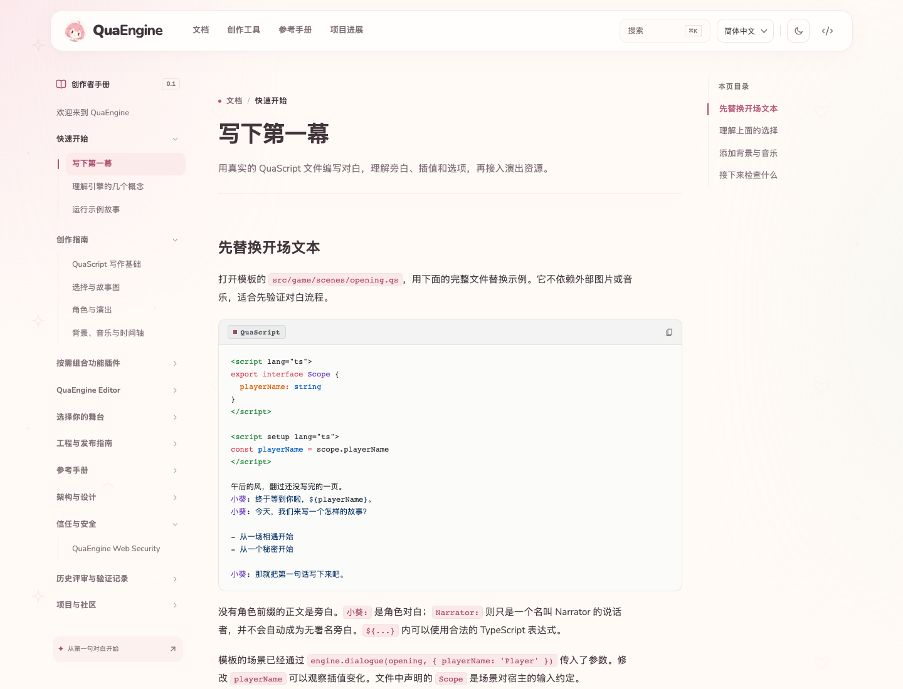
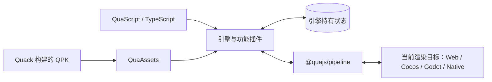

<h1 align="center">
  <picture>
    <source media="(prefers-color-scheme: dark)" srcset="assets/brand/quaengine-readme-zh-dark.png" />
    
  </picture>
</h1>

<p align="center">
  <strong>TypeScript 视觉小说引擎与独立 Electron 创作工作区。</strong><br />
  QuaScript 剧本 · 插件化演出 · Web / Cocos / Godot / Native
</p>

<p align="center"><a href="README.md">English</a> · <strong>简体中文</strong></p>

<p align="center">
  <a href="#当前进展"></a>
  <a href="https://github.com/QuaDevTeam/QuaEngine/actions/workflows/ci.yml"></a>
  <a href="LICENSE"></a>
  <a href="packages/editor/LICENSE"></a>
</p>

<p align="center">
  <a href="#开始创作">快速开始</a> &nbsp;·&nbsp;
  <a href="https://quaengine.com/docs/">文档</a> &nbsp;·&nbsp;
  <a href="#创作工作区">编辑器</a> &nbsp;·&nbsp;
  <a href="#运行-demo">Demo</a> &nbsp;·&nbsp;
  <a href="#当前进展">项目进展</a>
</p>

QuaEngine 将对白、分支、角色和音画演出组织在同一个项目里。用 **QuaScript** 编写故事，用 **TypeScript** 扩展行为，再选择 **Web、Cocos、Godot 或 Native** 渲染目标。剧情状态由引擎持有，功能由插件组合，渲染器负责呈现。

| 创作                                                             | 演出                                                       | 扩展                                                               |
| ---------------------------------------------------------------- | ---------------------------------------------------------- | ------------------------------------------------------------------ |
| [QuaScript 对白与分支](docs/content/docs/authoring/quascript.md) | [背景、音乐与动画](docs/content/docs/authoring/staging.md) | [插件与 Runtime QPK](docs/content/docs/guides/runtime-packages.md) |

## 开始创作

准备 **Node.js 22.12+** 和 **pnpm 12.3.4**，从源码启动编辑器：

```bash
git clone https://github.com/QuaDevTeam/QuaEngine.git
cd QuaEngine
pnpm install --frozen-lockfile
pnpm dev:editor
```

选择 **文件 → 新建项目**，创建 Vue + QuaScript 游戏。编辑器会将引擎、渲染器、编译器等 SDK 压缩包放入项目的 `vendor/quajs`，项目可以移出源码仓库。截至 **2026 年 10 月 27 日**，`create-qua-game` 尚未发布到 npm，Editor 也尚无公开发行包。

macOS 编辑器源码构建需要 Xcode Command Line Tools 和 Node-API 头文件；Native/Godot 游戏目标另需 Rust。完整步骤见[快速开始](docs/content/docs/getting-started/index.md)与[第一幕](docs/content/docs/getting-started/first-story.md)。

## 用 QuaScript 写故事

QuaScript 支持对白、选择、故事元数据、TypeScript 插值与包内装饰器。启用背景和音频插件后，可以这样编排一幕：

```qs
@SetBackground('images/bg/station-night.png', { transition: { type: 'fade', duration: 400 } })
@PlayBGM('audio/bgm/night-grid.ogg', { loop: true, fadeInMs: 600 })
电台的灯，一排一排重新亮了起来。
```

这里的资源路径仅作示例。功能包通过各自的 `./script-compiler` 入口提供装饰器，编译器负责导入接线和异步剧情步骤。详见[编译器指南](packages/build/script-compiler/README.md)与[Vue 模板](packages/build/create-qua-game/README.md)。

## 创作工作区

独立的 **QuaEngine Editor** 将项目管理、创作与预览放在同一个工作区：

- **编写与导航：** Monaco 补全、诊断、定义跳转、故事大纲和可视化 QuaScript 编辑。
- **编排演出：** 角色资料、立绘与表情资源、动画关键帧和时间轴。
- **预览与调试：** 内嵌 Web/Native 预览、源码定位、Inspector、性能、存储与资源检查。
- **管理项目：** 可停靠面板、资源浏览器、集成终端、Git 更改与目标打包。
- **发展故事：** 内置 Novel Writer，结合项目上下文生成、审核和回写可撤销的剧本草稿。

[编辑器设置与功能](packages/editor/README.md) · [角色编辑器](packages/editor/character/README.md) · [动画编辑器](packages/editor/animation/README.md)

插件市场连接 `registry.quaengine.com` 的 Cloudflare Workers + D1 注册服务，支持 npm 所有权验证、自动系统审查、可选 Jev 审查与定时同步。见[发布者指南](packages/services/plugin-registry/README.md)与[编辑器插件契约](docs/design/editor-plugins.md)。

## 文档

基于 **svedocs 0.2.4** 的创作者手册，包含教程、可搜索的包参考、架构指南与机器可读页面。快速开始、第一幕与 Editor 手册提供中英文版本；其他创作指南目前以中文为主，包参考保留源文件语言。

**[访问 quaengine.com](https://quaengine.com)** · **[阅读中文手册](https://quaengine.com/docs/)**

<a href="https://quaengine.com/docs/getting-started/first-story/">
  <picture>
    <source media="(prefers-color-scheme: dark)" srcset="assets/brand/quaengine-docs-dark.png" />
    
  </picture>
</a>

<p align="center"><sub>当前生产构建的真实中文文档页面，提供浅色与深色截图。</sub></p>

[快速开始](docs/content/docs/getting-started/index.md) · [创作指南](docs/content/docs/authoring/index.md) · [编辑器](docs/content/docs/editor/index.md) · [平台](docs/content/docs/platforms/index.md) · [参考手册](docs/content/docs/reference/index.md)

```bash
pnpm --dir docs install --frozen-lockfile
pnpm docs:dev
pnpm docs:check
pnpm docs:build
```

文档站使用独立 pnpm 工作区，无需构建 Rust 或 Electron。支持本地搜索、代码复制、响应式布局、深色模式、Markdown 副本与 `llms.txt`。教程源文件位于 `docs/content`，包参考从原始 README 生成；静态产物位于 `docs/build/`。预览与发布说明见[文档站维护指南](docs/README.md)。

<details>
<summary><strong>API 与设计文档索引</strong></summary>

| 主题           | 入口                                                                                                                                                                |
| -------------- | ------------------------------------------------------------------------------------------------------------------------------------------------------------------- |
| 叙事与插件     | [引擎 API](packages/core/engine/docs/global-api.md) · [插件系统](packages/core/engine/docs/plugin-system.md) · [故事图](packages/game/story-graph/README.md)        |
| Web 渲染       | [Web](packages/render/web/README.md) · [Vue](packages/render/vue/README.md) · [React](packages/render/react/README.md) · [Svelte](packages/render/svelte/README.md) |
| Cocos 与 Godot | [Creator 工作区](docs/content/docs/platforms/cocos.md) · [Godot 项目](docs/content/docs/platforms/godot.md) · [共享场景投影](packages/render/scene/README.md)       |
| 资源与编译     | [Quack](packages/build/quack/README.md) · [QuaScript](packages/build/script-compiler/README.md) · [PSD 工作流](docs/guides/psd-sprite-ui-skin.md)                   |
| 动态内容       | [Runtime QPK](docs/design/dynamic-runtime-qpk.md) · [Web 安全](docs/security/web-security.md)                                                                       |
| Native         | [JavaScriptCore](docs/design/native-jsc-runtime.md) · [UI 创作](docs/reviews/native-ui-authoring.md) · [迁移验证](docs/reviews/native-jsc-migration-2026-09-21.md)  |

</details>

## 运行 Demo

[**明天，请再一次呼唤我**](demo/README.md) 是仍在开发的近未来海岸悬疑视觉小说，围绕声音档案、电台和一段尚未录制却提前到来的广播展开。

故事与演出正在迭代。项目有 Web/Vue、Cocos、Godot 和 Native 入口，各目标共用 TSX/QUI + QSS 产品 UI，包含标题菜单、阅读工具条、章节选择、存读档、设置与回看。美术与完整音画演出仍在制作，图库暂未开放；专项回归不等于所有剧情分支已经验收。

```bash
pnpm install --frozen-lockfile
pnpm --filter demo dev
```

配置 Rust 与 Native 依赖后，可用 `pnpm dev:native` 启动原生开发窗口。其他构建与验证命令见[Demo 开发指南](demo/README.md#开发)。

生成并运行独立 **Godot 4.7+** 项目，需要 Rust/Cargo、C 编译器和带 libtheora/libvorbis 的 FFmpeg：

```bash
pnpm exec turbo run build --filter=demo^...
pnpm --dir demo build:godot
pnpm --dir demo run:godot
# 在 Godot 编辑器中打开生成项目：
pnpm --dir demo edit:godot
```

可移动的项目输出到 `demo/dist/godot/workspace`。Rust GDExtension 用 QuickJS 执行剧情，运行时不需要 Node 或 WebView。本机构建只生成当前宿主的库；Windows/Linux 仍需在对应系统实测。Godot 当前**仅支持静态 QPK**，配置、媒体差异与导出前提见[Godot 指南](docs/content/docs/platforms/godot.md)。

Demo 的故事、角色、美术等创作内容是专有评估素材，见 [demo/LICENSE](demo/LICENSE)。

## 当前进展

**2026 年 10 月 27 日 · 版本 0.1.0。** 下列能力已在仓库实现；API 与包边界仍可能变化，发布作品前需在目标平台验证。

| 领域        | 当前能力                                                                                                                       |
| ----------- | ------------------------------------------------------------------------------------------------------------------------------ |
| 叙事运行时  | 场景、对白、选项、角色、检查点、存读档、故事图与章节选择                                                                       |
| Web         | 共用 DOM/WebAudio 运行时、逻辑舞台适配、Vue 参考适配器与 React/Svelte 薄适配器                                                 |
| Cocos       | 可移动 Creator 3.8.8 工作区、共享 QUI、Web/macOS 构建、持久化存档与媒体投影；可选宿主能力降级                                  |
| Godot       | Godot 4.7+ 独立项目、GDExtension + QuickJS、共享场景投影、QUI、媒体与持久化；首批 macOS 验证                                   |
| Native      | Rust + JavaScriptCore + wgpu、QUI/TSX、QSS、Sprite/Atlas、九宫格、富文本与图层动画                                             |
| 功能插件    | 背景、音频、动画、立绘/UI 皮肤、字体、回看、图库、成就、物品、设置与资源加载                                                   |
| Runtime QPK | 并列挂载、信任校验、动态脚本/插件、图增量、迁移与存档依赖；取决于目标能力，Godot 暂仅支持静态包                                |
| 创作工具    | Electron + Lit/SCSS 工作台、Monaco、停靠面板、角色/动画、Web/Native 预览、Inspector、Git、打包、插件市场与 Svelte Novel Writer |
| 构建与文档  | QuaScript、HMR、Quack、Vite、项目检查、语言服务、Vue 模板与可搜索手册                                                          |

Rust/wgpu Native 的常驻引擎与动态 QPK 使用 **JavaScriptCore**；Godot 使用独立的 QuickJS 宿主。历史[Native 迁移报告](docs/reviews/native-jsc-migration-2026-09-21.md)区分了 macOS 运行结果、Windows 交叉目标检查和仍待验收的系统运行及视觉一致性。GPU 读回不能单独证明完整平台一致性。

[能力与限制](docs/content/docs/project/status.md) · [平台比较](docs/content/docs/platforms/index.md)

## 架构



- **逻辑持有状态。** 场景、进度、选项、音频意图与功能投影属于 engine/store；渲染器通过 pipeline 接收投影与返回意图。
- **Web 运行时共用。** DOM、对象 URL、WebAudio 和舞台换算属于 `@quajs/renderer-web`，Vue/React/Svelte 复用这些能力；视觉样式显式导入。
- **产品 UI 可以共用。** Demo 用同一份 TSX/QUI 与 QSS 定义菜单和面板，投影到四个目标；Web-only 项目仍可自定义框架 UI。
- **场景投影共用。** Cocos/Godot 适配 `@quajs/renderer-scene` 与 `@quajs/scene-host`，各宿主持有临时节点、媒体句柄与输入实现。
- **内容通过包扩展。** AI 生成与动态内容通过 Runtime QPK 交付；生产可执行内容需要校验，激活、迁移、存档依赖与卸载由引擎统一负责。
- **每个产物选择一个目标。** 四个 target core 家族相互隔离，由当前目标 manifest 驱动生成项目与启动壳。

详见[Runtime QPK 设计](docs/design/dynamic-runtime-qpk.md)与[逻辑舞台契约](docs/design/mobile-rendering-adaptation.md)。

## 开发

使用 **pnpm 12.3.4**。包清单最低要求 Node.js `>=20`；建议统一用 **Node.js 22.12+**，以运行类型剥离命令和文档站 Vite 8。Native 工作另需 Rust 与对应平台工具链。

```bash
pnpm install --frozen-lockfile
pnpm run build
pnpm run test
pnpm run lint
pnpm run typecheck
```

专项检查示例：

```bash
pnpm --filter demo build
pnpm --filter create-qua-game test -- --run
pnpm --filter @quajs/renderer-vue test -- --run
pnpm native:verify
```

欢迎贡献运行时、平台、插件、示例与文档。架构和验证要求见 [AGENTS.md](AGENTS.md)；功能修改应同步包文档和对应项目技能。

<details>
<summary><strong>工作区目录</strong></summary>

| 目录                                    | 职责                                             |
| --------------------------------------- | ------------------------------------------------ |
| [packages/core](packages/core/)         | 引擎、状态、管线、平台中立资源与插件发现         |
| [packages/game](packages/game/)         | 角色 API 与故事图                                |
| [packages/plugins](packages/plugins/)   | 可组合的游戏功能插件                             |
| [packages/render](packages/render/)     | 渲染契约、Web/框架渲染器和共享场景投影           |
| [packages/platform](packages/platform/) | Web、Node、内存、Cocos/Godot 适配器与宿主        |
| [packages/native](packages/native/)     | JavaScriptCore、wgpu、Native 契约、UI 编译与工具 |
| [packages/build](packages/build/)       | Quack、QuaScript、Vite、项目检查、模板与语言工具 |
| [packages/editor](packages/editor/)     | Electron 编辑器、创作插件与 Novel Writer         |
| [docs](docs/)                           | 文档站、指南、包参考与主题                       |
| [demo](demo/)                           | 四个目标共用的视觉小说示例                       |

</details>

## 品牌与许可

QuaEngine 与 QuaDevTeam 共用粉发吉祥物形象。[品牌素材](assets/brand/README.md)提供头像、横幅、标识、社交图片与可复现的导出方式。

`packages/editor/` 下的独立 IDE 第一方源码及内置角色编辑器、Novel Writer 使用 **[MPL-2.0](packages/editor/LICENSE)**。其他源码包除特别说明外使用 **Apache-2.0**；这是目录分别适用的许可。

欢迎[参与 IDE 社区共建](packages/editor/CONTRIBUTING.md)。MPL 允许商用与 fork，分发时需按 MPL 提供被覆盖文件及其修改的源码；不强制将修改贡献到上游。完整范围见[IDE 许可说明](packages/editor/README.md#开源许可与社区共建)。

名称、吉祥物与标识保留权利，软件许可不授予品牌素材复用权；Demo 创作内容另有专有条款。见 [LICENSE](LICENSE)、[NOTICE](NOTICE)、[TRADEMARKS.md](TRADEMARKS.md) 与 [LEGAL.md](LEGAL.md)。
